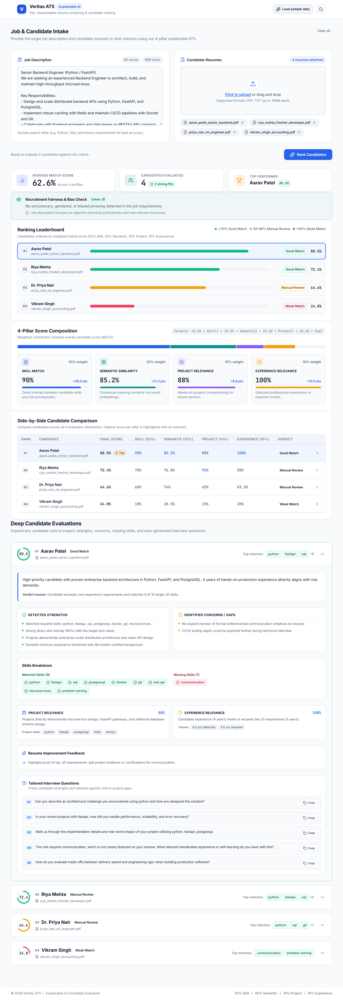
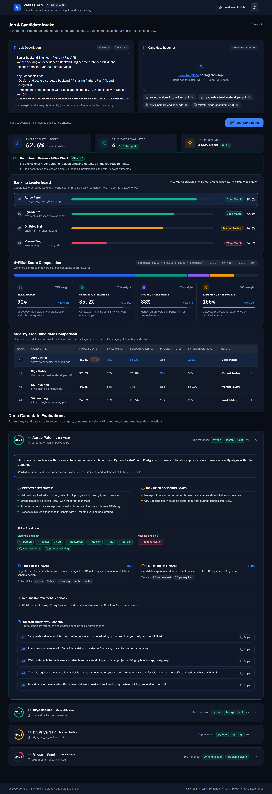

# AI Resume Ranking & Explainable ATS System

[](https://fastapi.tiangolo.com)
[](https://react.dev)
[](https://vitejs.dev)
[](https://python.org)
[](LICENSE)

An AI-powered resume ranking and explainable Applicant Tracking System (ATS) that evaluates candidate resumes against a job description using a hybrid scoring pipeline: **Skill Match**, **Semantic Similarity**, **Project Relevance**, and **Experience Relevance**. 

Designed to make candidate screening transparent, auditable, and fairer for freshers, students, and career changers whose hands-on projects may compensate for lower formal work experience.

---

## Table of Contents
- [Key Features](#key-features)
- [Screenshots](#screenshots)
- [How Scoring Works](#how-scoring-works)
- [System Architecture](#system-architecture)
- [Project Structure](#project-structure)
- [Getting Started](#getting-started)
  - [Prerequisites](#prerequisites)
  - [Backend Setup](#backend-setup)
  - [Frontend Setup](#frontend-setup)
- [Evaluation & Weight Tuning](#evaluation--weight-tuning)
- [API Reference](#api-reference)
- [Running Tests](#running-tests)
- [License](#license)

---

## Key Features

- **Multi-Format Document Parsing**:
  - Upload resumes in **PDF** (`.pdf`), Word (`.docx`, `.doc`), and plain text (`.txt`).
  - Directly upload Job Description documents (`.pdf`, `.docx`, `.doc`, `.txt`) to auto-populate the JD field.
- **Explainable 4-Pillar Scoring Engine**:
  - Direct skill matching with alias normalization (e.g. `JS` &rarr; `JavaScript`, `K8s` &rarr; `Kubernetes`).
  - Sentence Transformer embeddings (`all-MiniLM-L6-v2`) with automatic fallback to TF-IDF cosine similarity.
  - Project relevance scoring recognizing hands-on projects, open-source work, and capstones.
  - Experience relevance scoring comparing required years against candidate history.
- **Modern Recruiter-Grade UI**:
  - Built with React 18, Vite, Lucide Icons, and clean CSS design tokens.
  - Light and Dark modes with automatic system detection and manual toggle.
  - Interactive ranking chart, circular candidate score gauges, and stacked score breakdowns.
  - Dynamic skill chips: Matched (green) vs. Missing (red).
  - AI-generated candidate strengths, concerns, resume improvement tips, and tailored interview questions with 1-click copy.
  - One-click **"Load sample data"** button to preview full UI capabilities instantly.
- **Auditable Evaluation Pipeline (`/evaluation`)**:
  - Benchmark rankings against human relevance labels using **NDCG@5**, **NDCG@10**, **Precision@5**, **MRR**, and **Spearman Rank Correlation**.
  - Leave-One-JD-Out Cross-Validation (LOOCV) weight optimization script to prevent overfitting.

---

## Screenshots

| Light Mode | Dark Mode |
| :---: | :---: |
|  |  |

*(Mobile responsive views available in `docs/screenshots/`)*

---

## How Scoring Works

Candidates are scored using a weighted hybrid formula:

$$\text{Final Score} = 0.55 \times S_{\text{skill}} + 0.25 \times S_{\text{semantic}} + 0.10 \times S_{\text{project}} + 0.10 \times S_{\text{experience}}$$

| Component | Weight | Calculation Method | Purpose |
| :--- | :---: | :--- | :--- |
| **Skill Match** | `55%` | Alias-normalized dictionary matching of technical skills, frameworks, and tools. | Ensures core mandatory skills are present. |
| **Semantic Similarity** | `25%` | Cosine similarity using `all-MiniLM-L6-v2` dense embeddings (with TF-IDF fallback). | Captures context, synonyms, and domain alignment. |
| **Project Relevance** | `10%` | Detection of project sections, technical depth, and project alignment. | Rewards practical student/fresher projects. |
| **Experience Relevance** | `10%` | Regex & heuristic parsing of work history and years of experience. | Verifies seniority requirements without penalizing junior talent disproportionately. |

---

## System Architecture

```
                    +---------------------------+
                    |    React 18 + Vite UI     |
                    | (Light / Dark Mode, SaaS) |
                    +-------------+-------------+
                                  |
                   HTTP POST      | Multipart Form
                   (/rank-resumes)| (/extract-text)
                                  v
                    +---------------------------+
                    |      FastAPI Backend      |
                    +-------------+-------------+
                                  |
          +-----------------------+-----------------------+
          |                       |                       |
          v                       v                       v
+-------------------+   +-------------------+   +-------------------+
| Document Extractor|   |  Skills Extractor |   |   Scoring Engine  |
| (PDF, DOCX, TXT)  |   | (Alias Matching)  |   | (Sentence-Transf.)|
+-------------------+   +-------------------+   +-------------------+
                                                          |
                                                          v
                                                +-------------------+
                                                | Candidate Insights|
                                                | (Strengths, Tips, |
                                                | Questions)        |
                                                +-------------------+
```

---

## Project Structure

```
AI-CV-parser/
├── Project/
│   ├── backend/
│   │   ├── main.py                     # FastAPI application & API endpoints
│   │   ├── requirements.txt            # Python dependencies
│   │   └── services/
│   │       ├── extractor.py            # PDF, DOCX, and TXT parsing
│   │       ├── scoring.py              # Hybrid ranking & insights engine
│   │       └── skills.py               # Skill dictionary and alias taxonomy
│   ├── frontend/
│   │   ├── package.json
│   │   ├── vite.config.js
│   │   ├── src/
│   │   │   ├── App.jsx                 # Main state & application layout
│   │   │   ├── api.js                  # Backend API client
│   │   │   ├── tokens.css              # Color tokens, typography, radii
│   │   │   ├── styles.css              # Component styling
│   │   │   └── components/             # Modular UI components
│   │   │       ├── Header.jsx
│   │   │       ├── UploadPanel.jsx
│   │   │       ├── MetricsRow.jsx
│   │   │       ├── RankingChart.jsx
│   │   │       ├── CandidateCard.jsx
│   │   │       ├── ScoreBreakdown.jsx
│   │   │       ├── ComparisonTable.jsx
│   │   │       └── BiasWarning.jsx
│   │   └── capture_screenshots.js      # Headless Playwright screenshot tool
│   └── examples/                       # Sample JDs and resumes for testing
├── evaluation/
│   ├── eval.py                         # Evaluation benchmark script (NDCG, MRR, etc.)
│   ├── tune_weights.py                 # LOOCV grid search & learning-to-rank
│   ├── metrics.py                      # Pure metric implementations
│   ├── generate_labels_template.py     # Generates blank labels.csv template
│   ├── results.md                      # Evaluation benchmark report
│   └── tests/
│       └── test_metrics.py             # Hand-computed unit tests for metrics
├── docs/
│   └── screenshots/                    # Desktop & mobile screenshots
├── pytest.ini                          # Pytest configuration
└── README.md
```

---

## Getting Started

### Prerequisites

- **Python**: 3.10 or higher
- **Node.js**: 18.0 or higher
- **npm** or **yarn**

---

### Backend Setup

1. Open a terminal and navigate to the backend directory:
   ```bash
   cd Project/backend
   ```

2. Create and activate a virtual environment:
   - **Windows**:
     ```powershell
     python -m venv .venv
     .venv\Scripts\activate
     ```
   - **Linux / macOS**:
     ```bash
     python3 -m venv .venv
     source .venv/bin/activate
     ```

3. Install dependencies:
   ```bash
   pip install -r requirements.txt
   ```

4. Start the FastAPI development server:
   ```bash
   uvicorn main:app --host 127.0.0.1 --port 8001 --reload
   ```

- Backend API: [http://127.0.0.1:8001](http://127.0.0.1:8001)
- Interactive Swagger Docs: [http://127.0.0.1:8001/docs](http://127.0.0.1:8001/docs)

---

### Frontend Setup

1. Open a separate terminal and navigate to the frontend directory:
   ```bash
   cd Project/frontend
   ```

2. Install dependencies:
   ```bash
   npm install
   ```

3. Start the Vite development server:
   ```bash
   npm run dev
   ```

4. Open your browser and navigate to:
   ```
   http://localhost:5173
   ```

---

## Evaluation & Weight Tuning

The `/evaluation` module provides a scientific framework to validate ranking quality against human-labeled datasets.

### 1. Generate Labeling Template
Populate your Job Descriptions in `evaluation/data/jds/*.txt` and candidate resumes in `evaluation/data/resumes/*.txt|pdf|docx`. Then run:
```bash
python evaluation/generate_labels_template.py
```
This generates a blank `labels.csv` template (`jd_id, resume_id, relevance`).

### 2. Run Ranking Evaluation
Evaluate the 5 baseline systems (**Keyword Overlap**, **TF-IDF Cosine**, **Skill Only**, **Semantic Only**, and **Current Hybrid**):
```bash
python evaluation/eval.py
```

### 3. Tune Component Weights
Run Leave-One-JD-Out Cross-Validation (LOOCV) grid search and logistic regression ranker to identify optimal weights without overfitting:
```bash
python evaluation/tune_weights.py
```
Benchmark tables are automatically written to `evaluation/results.md`.

---

## API Reference

### `GET /`
Health check endpoint.
```json
{
  "status": "ok",
  "message": "Resume ranking API is running"
}
```

### `POST /extract-text`
Extracts text from an uploaded document (`.pdf`, `.docx`, `.doc`, `.txt`).
- **Request**: `multipart/form-data` with `file`.
- **Response**:
  ```json
  {
    "filename": "job_description.docx",
    "text": "Senior Backend Developer with FastAPI and Docker experience..."
  }
  ```

### `POST /rank-resumes`
Ranks uploaded resumes against the provided job description.
- **Request**: `multipart/form-data`
  - `job_description`: string (required)
  - `resumes`: list of files (`.pdf`, `.docx`, `.doc`, `.txt`)
- **Response**:
  ```json
  {
    "ranked_resumes": [
      {
        "filename": "jane_doe.pdf",
        "rank": 1,
        "score": 86.4,
        "score_breakdown": {
          "skill_match": 91.2,
          "semantic_similarity": 84.0,
          "project_relevance": 78.5,
          "experience_relevance": 82.0
        },
        "matched_skills": ["Python", "FastAPI", "Docker", "PostgreSQL"],
        "missing_skills": ["Kubernetes"],
        "verdict": "Good Match",
        "strengths": ["Strong alignment with required backend stack."],
        "concerns": [],
        "recommendations": ["Consider highlighting container orchestration experience."],
        "interview_questions": [
          "Describe your experience building asynchronous APIs using FastAPI."
        ]
      }
    ]
  }
  ```

---

## Running Tests

Run the test suite using `pytest`:
```bash
pytest
```
To run evaluation metric tests specifically:
```bash
pytest evaluation/tests/test_metrics.py
```

---

## License

This project is licensed under the [MIT License](LICENSE).
